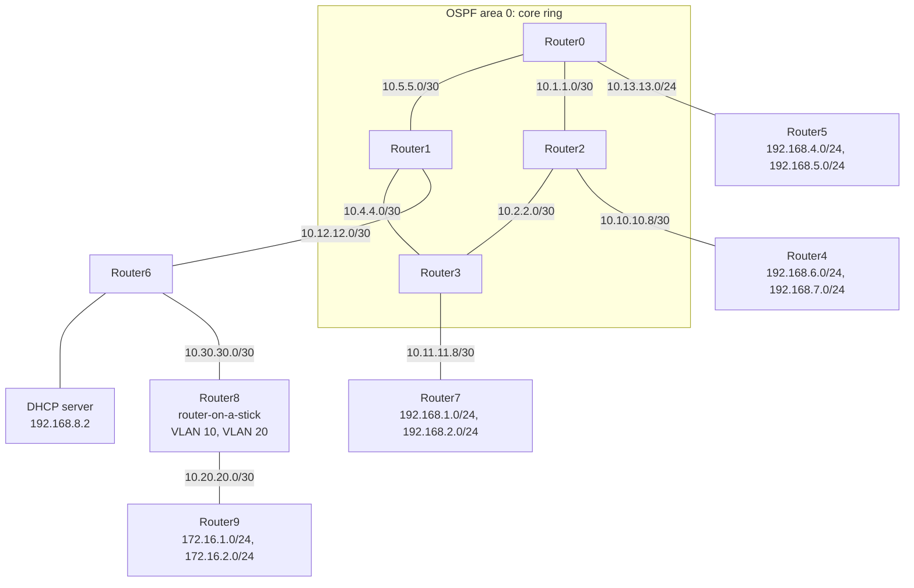

# Multi-site OSPF Enterprise Network

A larger network built from scratch to practise routing at scale. It has a **redundant core ring of four routers**, six distribution/site routers, a central **DHCP server** shared by all sites through `ip helper-address`, and a site that uses **VLANs with router-on-a-stick**. All routing is done with **OSPF (process 1, area 0)**.



## Design

- **Core ring (Router0–Router3):** four 2911 routers connected in a square with `/30` point-to-point links. If any single core link fails, OSPF reconverges over the other side of the ring.
- **Sites:** each core router connects to a site router. Each site router serves two user LANs (`/24`).
- **Services:** Router6 hosts the server LAN `192.168.8.0/24`. The server `192.168.8.2` is the central DHCP server. Site routers forward DHCP requests to it with `ip helper-address 192.168.8.2`.
- **VLAN site (Router8):** Gi0/1 is an 802.1Q trunk with sub-interfaces for VLAN 10 and VLAN 20 (router-on-a-stick). Hosts in both VLANs get their addresses from the central DHCP server through the relay.

## Core & WAN links

| Link | Subnet | Side A | Side B |
|---|---|---|---|
| Router0 ↔ Router1 | 10.5.5.0/30 | Router0 Gi0/2 .2 | Router1 Gi0/2 .1 |
| Router0 ↔ Router2 | 10.1.1.0/30 | Router0 Gi0/1 .2 | Router2 Gi0/1 .1 |
| Router2 ↔ Router3 | 10.2.2.0/30 | Router2 Gi0/2 .2 | Router3 Gi0/2 .1 |
| Router1 ↔ Router3 | 10.4.4.0/30 | Router1 Gi0/1 .2 | Router3 Gi0/1 .1 |
| Router0 ↔ Router5 | 10.13.13.0/24 | Router0 Gi0/0 .1 | Router5 Gi0/0 .2 |
| Router1 ↔ Router6 | 10.12.12.0/30 | Router1 Gi0/0 .1 | Router6 Gi0/0 .2 |
| Router2 ↔ Router4 | 10.10.10.8/30 | Router2 Gi0/0 .10 | Router4 Gi0/0 .9 |
| Router3 ↔ Router7 | 10.11.11.8/30 | Router3 Gi0/0 .10 | Router7 Gi0/0 .9 |
| Router6 ↔ Router8 | 10.30.30.0/30 | Router6 Gi0/1 .2 | Router8 Gi0/2 .1 |
| Router8 ↔ Router9 | 10.20.20.0/30 | Router8 Gi0/0 .1 | Router9 Gi0/0 .2 |

## LAN addressing

| Router | Interface | Network | Gateway | DHCP relay |
|---|---|---|---|---|
| Router4 | Gi0/1 | 192.168.6.0/24 | 192.168.6.1 | ✔ |
| Router4 | Gi0/2 | 192.168.7.0/24 | 192.168.7.1 | ✔ |
| Router5 | Gi0/1 | 192.168.4.0/24 | 192.168.4.1 | ✔ |
| Router5 | Gi0/2 | 192.168.5.0/24 | 192.168.5.1 | ✔ |
| Router6 | Gi0/2 | 192.168.8.0/24 (servers) | 192.168.8.1 | n/a |
| Router7 | Gi0/1 | 192.168.2.0/24 | 192.168.2.1 | ✔ |
| Router7 | Gi0/2 | 192.168.1.0/24 | 192.168.1.1 | ✔ |
| Router8 | Gi0/1 (native) | 192.168.9.0/24 | 192.168.9.1 | ✔ |
| Router8 | Gi0/1.10 (VLAN 10) | 192.168.10.0/24 | 192.168.10.1 | ✔ |
| Router8 | Gi0/1.20 (VLAN 20) | 192.168.20.0/24 | 192.168.20.1 | ✔ |
| Router9 | Gi0/1 | 172.16.1.0/24 | 172.16.1.1 | ✔ |
| Router9 | Gi0/2 | 172.16.2.0/24 | 172.16.2.1 | ✔ |

## Key configuration examples

**Core router (Router0):**

```
router ospf 1
 network 10.13.13.0 0.0.0.255 area 0
 network 10.1.1.0 0.0.0.3 area 0
 network 10.5.5.0 0.0.0.3 area 0
```

**Site router with DHCP relay (Router4):**

```
interface GigabitEthernet0/1
 ip address 192.168.6.1 255.255.255.0
 ip helper-address 192.168.8.2
```

**Router-on-a-stick (Router8):**

```
interface GigabitEthernet0/1.10
 encapsulation dot1Q 10
 ip address 192.168.10.1 255.255.255.0
 ip helper-address 192.168.8.2
interface GigabitEthernet0/1.20
 encapsulation dot1Q 20
 ip address 192.168.20.1 255.255.255.0
 ip helper-address 192.168.8.2
```

All router configs are in [`configs/`](./configs).

## How to verify

```
show ip ospf neighbor        ! each core router should have 3 FULL neighbors
show ip route ospf           ! routes to every LAN, learned via OSPF (O)
show ip interface brief
```

- From a PC in any site: get an address via DHCP (Desktop → IP Configuration → DHCP), then ping a PC in another site.
- Shut down one core link (e.g. Router0 Gi0/2) and run `traceroute` again: traffic takes the other side of the ring.
