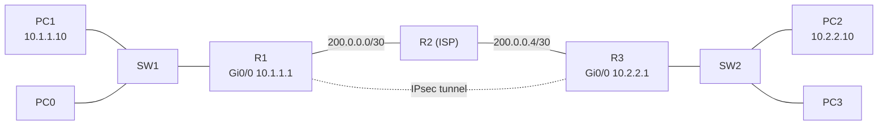

# Site-to-Site IPsec VPN

Two branch LANs connected over an untrusted "ISP" router through an IPsec tunnel. Traffic between `10.1.1.0/24` and `10.2.2.0/24` is encrypted between R1 and R3. The ISP router (R2) only knows the public `/30` links and has no routes to the private LANs.



## Addressing table

| Device | Interface | IP address | Subnet mask | Connected to |
|---|---|---|---|---|
| R1 | Gi0/0 | 10.1.1.1 | 255.255.255.0 | LAN A (SW1) |
| R1 | Gi0/1 | 200.0.0.1 | 255.255.255.252 | R2 Gi0/0 |
| R2 (ISP) | Gi0/0 | 200.0.0.2 | 255.255.255.252 | R1 Gi0/1 |
| R2 (ISP) | Gi0/1 | 200.0.0.5 | 255.255.255.252 | R3 Gi0/1 |
| R3 | Gi0/1 | 200.0.0.6 | 255.255.255.252 | R2 Gi0/1 |
| R3 | Gi0/0 | 10.2.2.1 | 255.255.255.0 | LAN B (SW2) |
| PC1 | Fa0 | 10.1.1.10 | 255.255.255.0 | GW 10.1.1.1 |
| PC2 | Fa0 | 10.2.2.10 | 255.255.255.0 | GW 10.2.2.1 |

## IPsec parameters

| Phase | Setting | Value |
|---|---|---|
| Phase 1 (ISAKMP) | Encryption | AES-256 |
| | Authentication | Pre-shared key |
| | Diffie-Hellman group | 5 |
| | Lifetime | 3600 s |
| Phase 2 (IPsec) | Transform set | `VPN-SET`: `esp-aes esp-sha-hmac` |
| | Crypto map | `VPN-MAP 10`, applied on the WAN interface (Gi0/1) |
| | Interesting traffic | ACL 100: `10.1.1.0/24 ↔ 10.2.2.0/24` |
| Routing | R1 / R3 | Static default route towards the ISP |

## Key configuration (R1)

```
crypto isakmp policy 10
 encr aes 256
 authentication pre-share
 group 5
 lifetime 3600
crypto isakmp key <PRE-SHARED-KEY> address 200.0.0.6
!
crypto ipsec transform-set VPN-SET esp-aes esp-sha-hmac
!
crypto map VPN-MAP 10 ipsec-isakmp
 set peer 200.0.0.6
 set transform-set VPN-SET
 match address 100
!
interface GigabitEthernet0/1
 ip address 200.0.0.1 255.255.255.252
 crypto map VPN-MAP
!
ip route 0.0.0.0 0.0.0.0 200.0.0.2
access-list 100 permit ip 10.1.1.0 0.0.0.255 10.2.2.0 0.0.0.255
```

R3 is configured as the mirror image (peer `200.0.0.1`, ACL `10.2.2.0 → 10.1.1.0`). Full configs are in [`configs/`](./configs).

> In the published configs the pre-shared key is replaced with `<PRE-SHARED-KEY>`.

## How to verify

1. Ping from PC1 to PC2 (`ping 10.2.2.10`). The first packets may time out while the tunnel is being built.
2. On R1 or R3:

```
show crypto isakmp sa      ! Phase 1 should be QM_IDLE
show crypto ipsec sa       ! encaps/decaps counters should increase
show crypto map
```

3. In simulation mode, follow a packet across R2: between R1 and R3 it is ESP-encapsulated.
